# ☕ Coffee Shop Management System

A full-stack Coffee Shop Management System designed to help coffee shop owners manage their daily operations through a modern web application.

## 📸 Application Screenshots

### Login
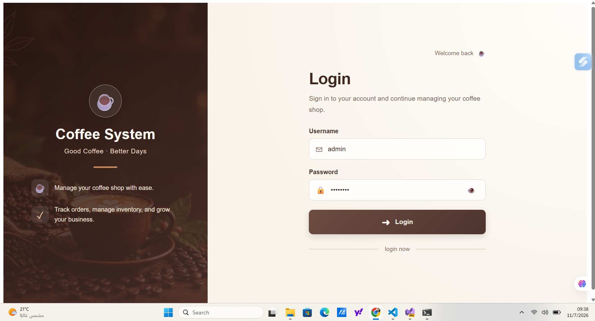

### Dashboard
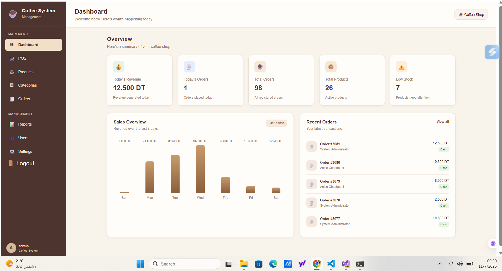

### Point of Sale (POS)
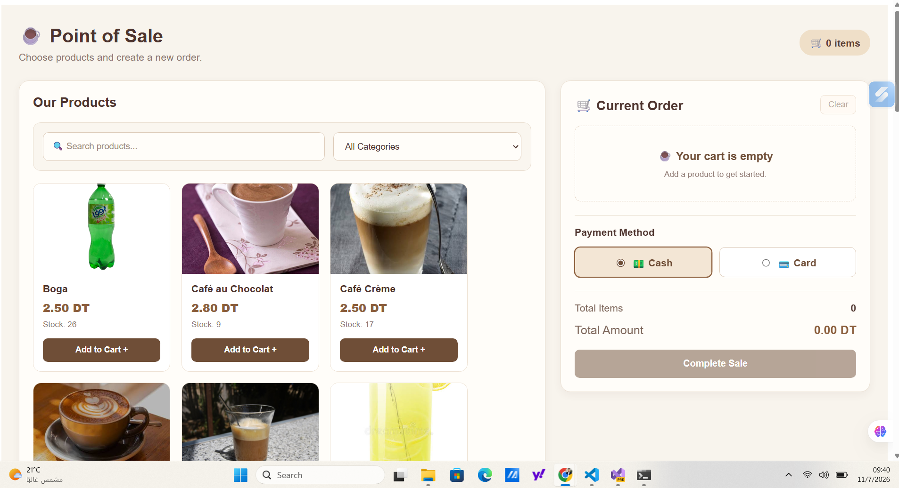
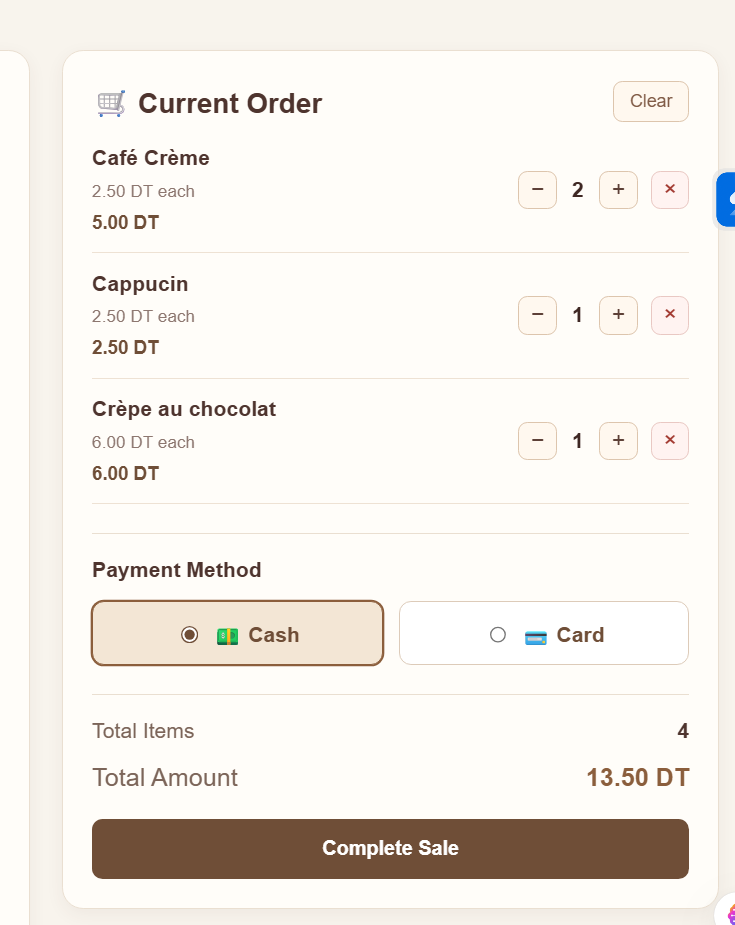


### Products Management


### Categories Management
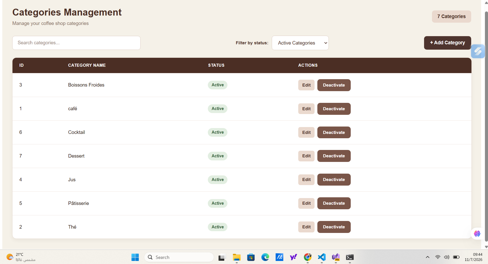


### Orders Management
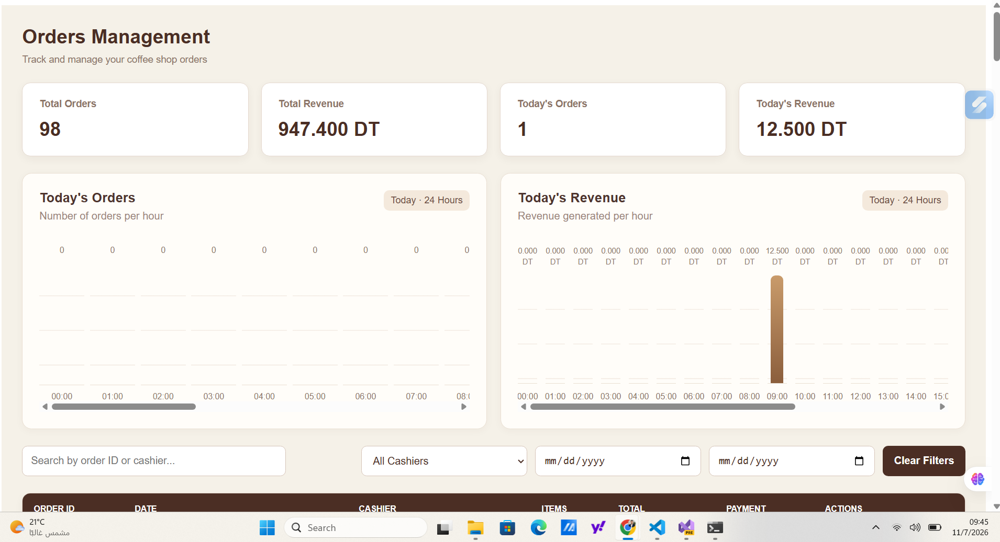
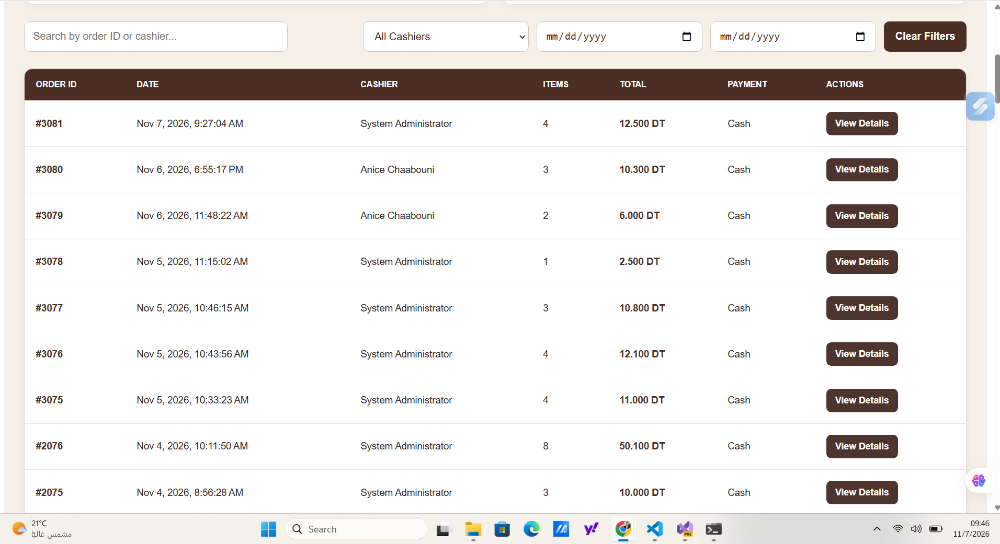
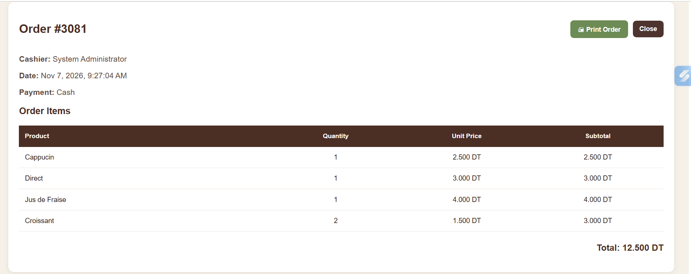
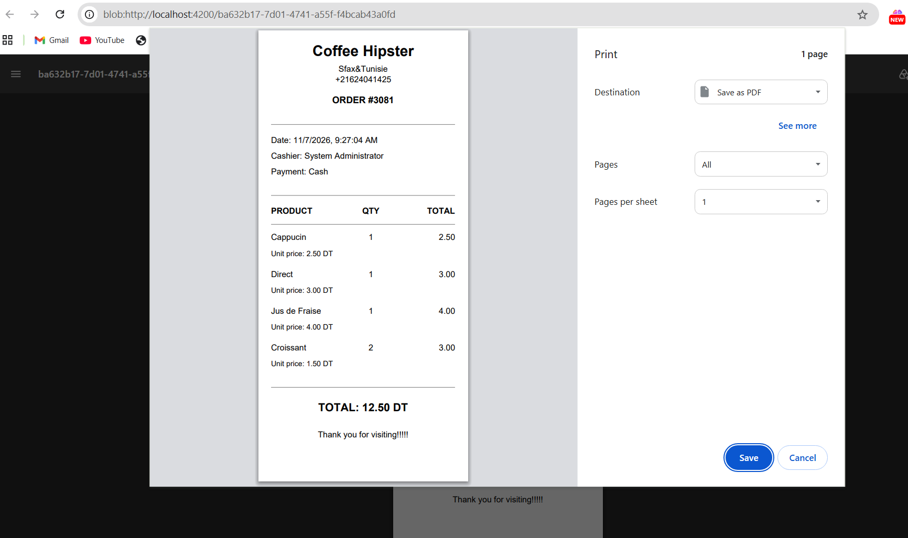


### Reports
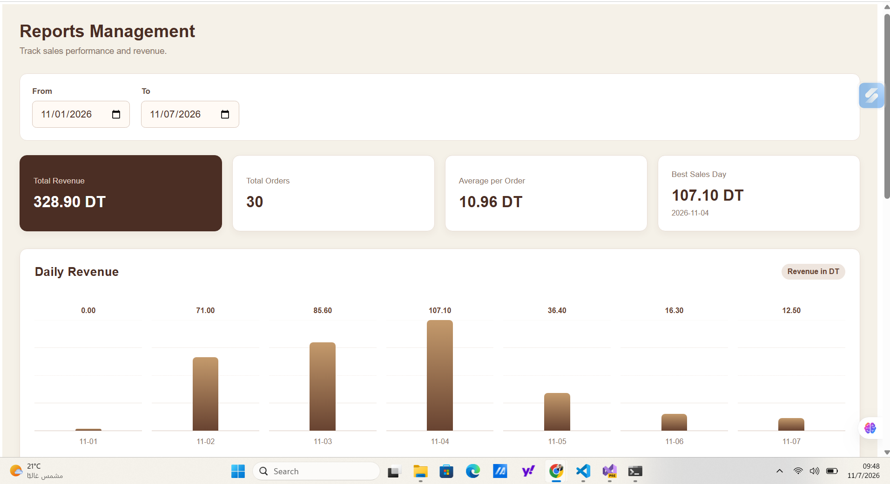
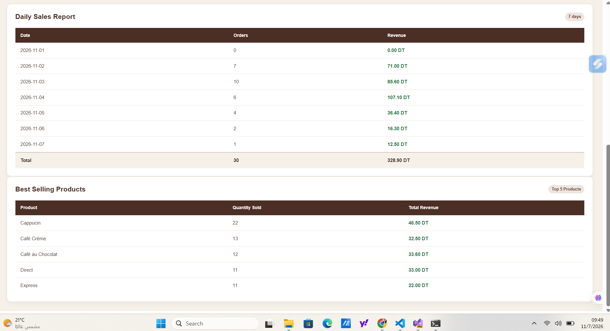


### Users Management
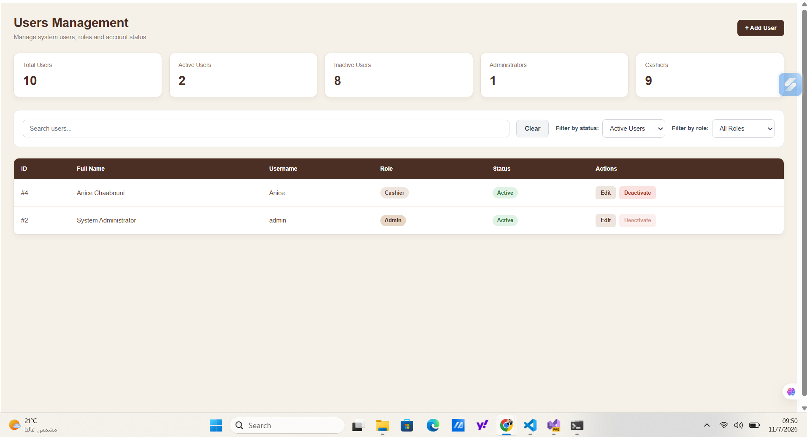

### Settings


## 🚀 Project Overview

This project is a web-based version of a Coffee Shop Management System, built using Angular and ASP.NET Core Web API.

It provides role-based access, product and category management, point-of-sale operations, order tracking, reporting, and system settings.

## 🛠️ Technologies Used

### Frontend
- Angular 21
- TypeScript
- HTML5 & CSS3
- RxJS
- Angular Signals

### Backend
- C#
- ASP.NET Core Web API (.NET 8)
- Entity Framework Core
- RESTful API
- JWT Authentication
- Role-Based Authorization
- CSRF Protection

### Database
- Microsoft SQL Server

## ✨ Main Features

- **Authentication:** Secure login and logout.
- **Dashboard:** Overview of coffee shop operations.
- **Products Management:** Create, update, deactivate, and reactivate products.
- **Categories Management:** Manage product categories.
- **Point of Sale (POS):** Process customer orders and payments.
- **Order Management:** View orders, details, and print receipts.
- **Reports:** Revenue statistics, daily sales, and best-selling products.
- **User Management:** Manage Admin and Cashier accounts.
- **Settings:** Configure coffee shop information and receipt details.

## 🔐 Security

- JWT authentication using HttpOnly cookies.
- CSRF protection for sensitive operations.
- Role-Based Access Control (RBAC).
- Admin and Cashier permissions.
- Backend authorization to protect API endpoints.
- Server-side validation.
- Secure checkout with stock validation and database transactions.

## 🏗️ Architecture

The application follows a layered backend architecture:

- **Presentation Layer:** Angular frontend and ASP.NET Core API controllers.
- **Business Layer:** Business logic and validation.
- **Data Access Layer:** Entity Framework Core and SQL Server.

## ⚙️ Getting Started

### Prerequisites

- Node.js and npm
- Angular CLI
- .NET 8 SDK
- SQL Server

### Frontend Setup

```bash
cd coffee-shop-frontend
npm install
ng serve
```

Open `http://localhost:4200` in your browser.

### Backend Setup

1. Open the backend solution in Visual Studio.
2. Configure the SQL Server connection string.
3. Configure the required authentication and security settings.
4. Apply the Entity Framework Core migrations if needed.
5. Run the ASP.NET Core Web API project.

## 👥 User Roles

| Feature | Admin | Cashier |
|---|---|---|
| Dashboard | ✅ | ✅ |
| View Products | ✅ | ✅ |
| Manage Products | ✅ | ❌ |
| View Categories | ✅ | ✅ |
| Manage Categories | ✅ | ❌ |
| POS & Checkout | ✅ | ✅ |
| View Orders | ✅ | ✅ |
| Reports | ✅ | ✅ |
| Manage Users | ✅ | ❌ |
| Manage Settings | ✅ | ❌ |

## 🎯 Project Purpose

This project was developed to strengthen practical full-stack development skills, combining Angular frontend development with ASP.NET Core Web API, SQL Server, authentication, authorization, and real-world business logic.

---

**Developed with ❤️ using Angular & ASP.NET Core.**