# ☕ Coffee Shop Management System

<p align="center">
  <strong>A Full-Stack Coffee Shop Management System built with Angular and ASP.NET Core Web API.</strong>
  <br />
  Manage products, orders, users, inventory, sales, and reports through a modern web application.
</p>

<p align="center">
  
  
  
  
  
</p>

---

## 📌 About The Project

Coffee Shop Management System is a full-stack web application designed to simplify and manage daily coffee shop operations.

The application provides an Admin dashboard for managing the entire coffee shop and a Cashier interface for handling sales and viewing operational data.

It was developed using **Angular 21** for the frontend and **ASP.NET Core 8 Web API** for the backend, following a layered architecture.

## 🛠️ Technologies Used

### 🎨 Frontend
- Angular 21
- TypeScript
- HTML5
- CSS3
- RxJS
- Angular Router

### ⚙️ Backend
- C#
- ASP.NET Core 8 Web API
- Entity Framework Core
- RESTful API
- JWT Authentication
- Role-Based Authorization

### 🗄️ Database
- Microsoft SQL Server
- Entity Framework Core

### 🔐 Security
- JWT Authentication using HttpOnly Cookies
- CSRF Protection
- Role-Based Access Control (RBAC)
- Backend-side validation
- Secure API endpoints

## ✨ Main Features

### 🔑 Authentication & Authorization
- Secure login and logout.
- JWT authentication.
- HttpOnly authentication cookies.
- CSRF protection.
- Role-based permissions (Admin / Cashier).

### 📊 Dashboard
- Sales overview.
- Revenue statistics.
- Orders summary.
- Low-stock alerts.

### 🛒 Point of Sale (POS)
- Browse available products.
- Add products to the cart.
- Manage order quantities.
- Calculate totals.
- Process customer orders.
- Print receipts.

### 📦 Product Management
- Add new products.
- Edit product information.
- Upload product images.
- Manage stock quantities.
- Activate and deactivate products.

### 🗂️ Category Management
- Create and update categories.
- Organize products.
- Manage category status.

### 🧾 Order Management
- View orders.
- View order details.
- Track transactions.
- Print order receipts.

### 👥 User Management
- Create and manage users.
- Assign Admin and Cashier roles.
- Activate and deactivate accounts.
- Manage user permissions.

### 📈 Reports
- Revenue reports.
- Sales statistics.
- Daily performance overview.
- Visual charts.

### ⚙️ Settings
- Configure coffee shop information.
- Manage receipt details.
- Configure low-stock threshold.

## 🔒 Role-Based Access Control

The application supports two roles:

| Feature | Admin | Cashier |
|---|:---:|:---:|
| Dashboard | ✅ | ❌ |
| POS | ✅ | ✅ |
| View Products | ✅ | ✅ |
| Add / Edit Products | ✅ | ❌ |
| Manage Categories | ✅ | ❌ |
| View Orders | ✅ | ✅ |
| Manage Users | ✅ | ❌ |
| Reports | ✅ | ❌ |
| Settings | ✅ | ❌ |

**Note:** Permissions are enforced on the backend, not only through the frontend interface.

## 🖼️ Application Screenshots

### 🔐 Login
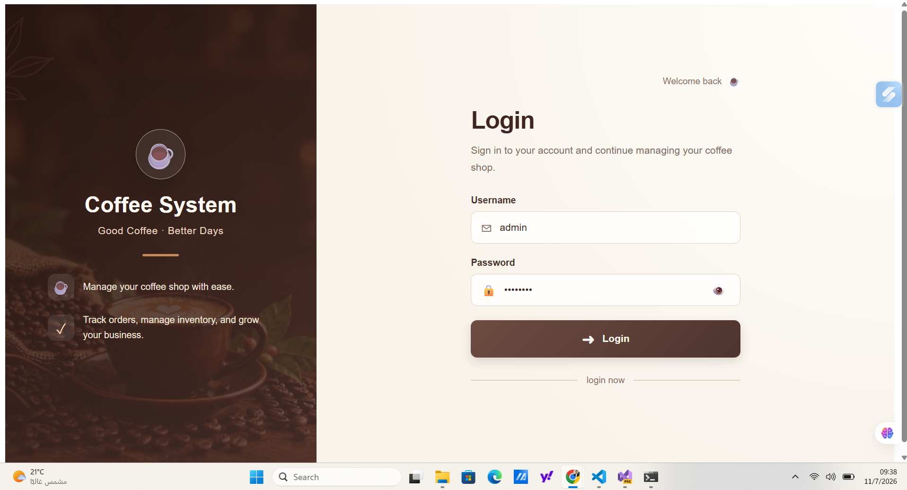

### 📊 Dashboard
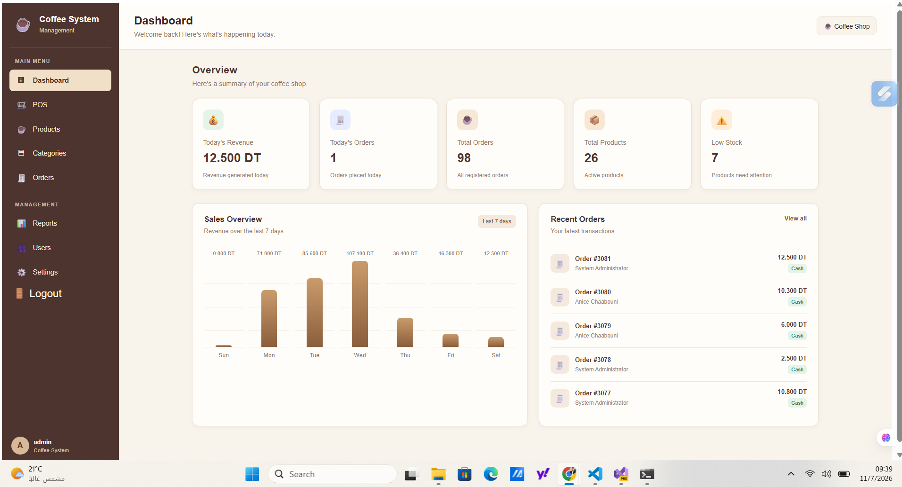

### 🛒 Point of Sale
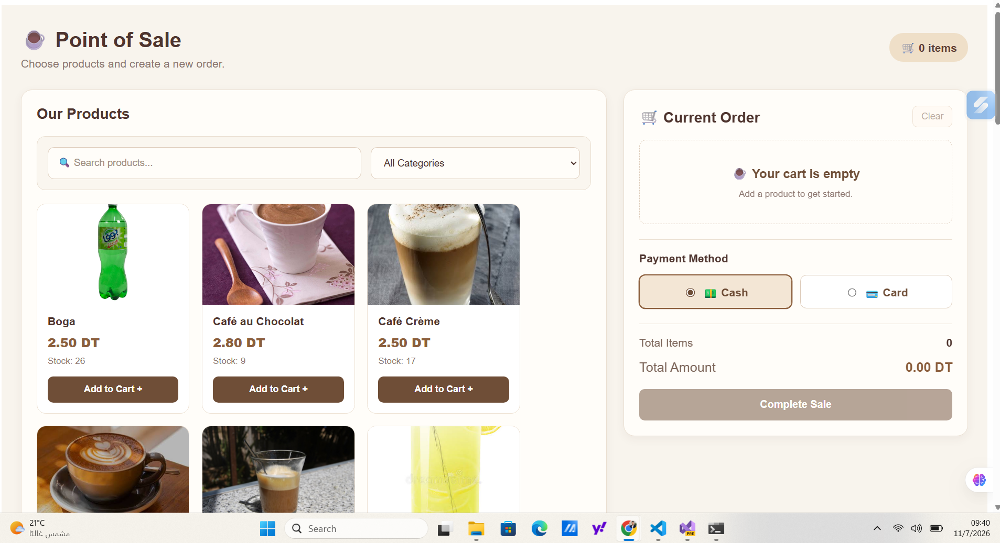

### 📦 Product Management


### 🗂️ Category Management
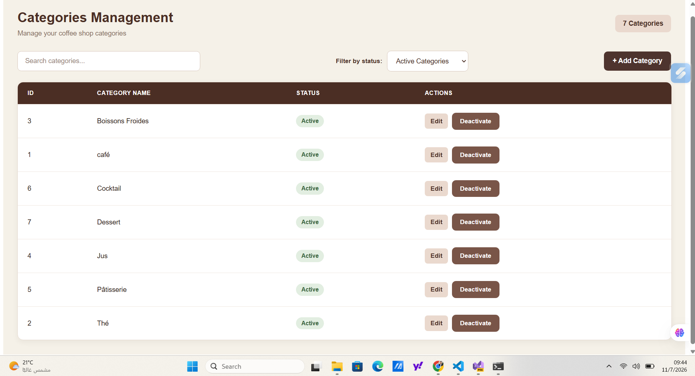

### 🧾 Order Management
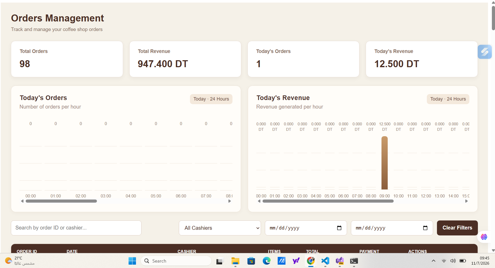

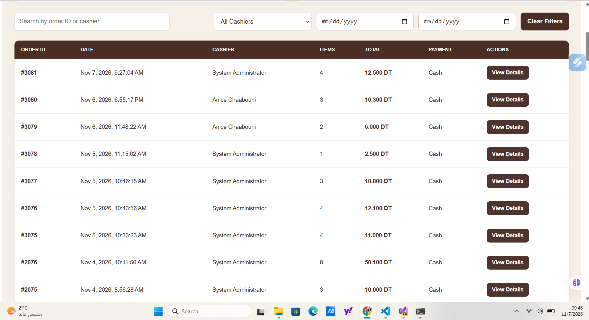

### 🖨️ Receipt Printing
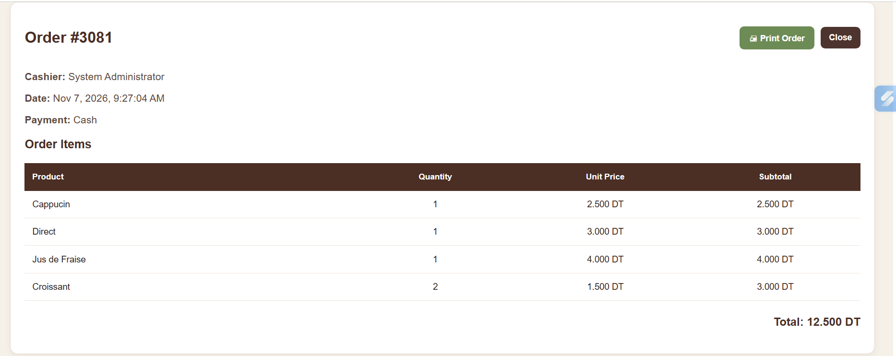

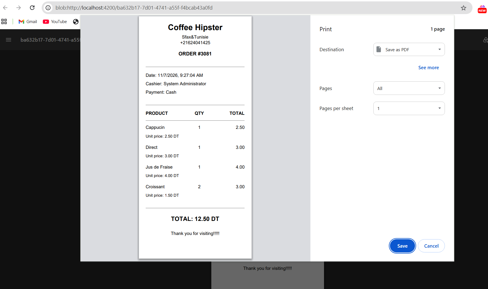

### 👥 User Management
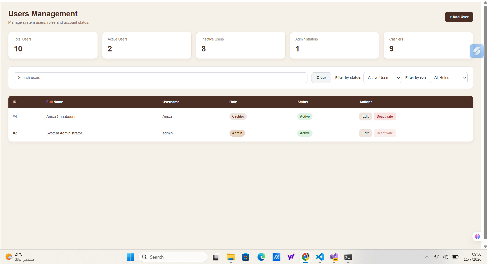

### 📈 Reports
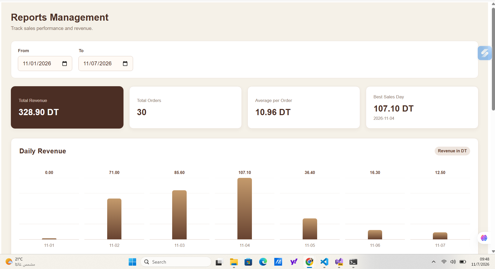

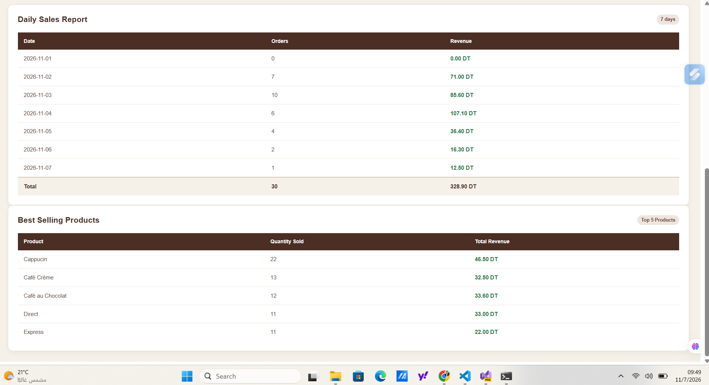

### ⚙️ Settings
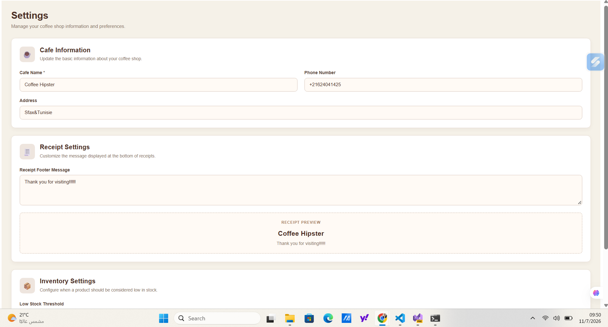

## 🏗️ Project Structure

```text
Coffee-Shop-Management-System/
│
├── 📁 Backend/
│   └── 📁 CoffeeShop.web/
│       ├── 📁 CoffeeShop.API/
│       ├── 📁 CoffeSystem_Business/
│       ├── 📁 CoffeSystem_DataAccess/
│       └── 📄 CoffeeShop.web.slnx
│
├── 📁 Frontend/
│   └── 📁 coffee-shop-frontend/
│       ├── 📁 src/
│       ├── 📁 screenshots/
│       ├── 📄 package.json
│       └── 📄 angular.json
│
└── 📄 README.md
```

## 🚀 Getting Started

### 📋 Prerequisites

Make sure you have installed:

- [Node.js](https://nodejs.org/)
- [Angular CLI](https://angular.dev/tools/cli)
- [.NET 8 SDK](https://dotnet.microsoft.com/download/dotnet/8.0)
- [SQL Server](https://www.microsoft.com/en-us/sql-server)
- [Visual Studio](https://visualstudio.microsoft.com/) or Visual Studio Code

### 1️⃣ Clone the Repository

```bash
git clone https://github.com/anice23/Coffee-Shop-Management-System-Web-Application.git
```

```bash
cd Coffee-Shop-Management-System-Web-Application
```

### 2️⃣ Configure the Backend

- Open the backend solution located in `Backend/CoffeeShop.web/`.
- Configure your SQL Server connection string.
- Configure the required authentication settings.
- Apply the Entity Framework Core migrations if needed.
- Run the ASP.NET Core API project.

**Important:** Keep your database credentials and secret keys private. Do not commit sensitive configuration files.

### 3️⃣ Run the Frontend

Open a terminal inside:

```bash
Frontend/coffee-shop-frontend
```

Install dependencies:

```bash
npm install
```

Start the Angular application:

```bash
ng serve
```

Open your browser at:

```text
http://localhost:4200
```

## 👨‍💻 Developer

**Anis Chaabouni**

Junior Fullstack Angular .NET Developer

- 💻 GitHub: [anice23](https://github.com/anice23)
- 📂 Project Repository: [Coffee Shop Management System](https://github.com/anice23/Coffee-Shop-Management-System-Web-Application)

---

<p align="center">
  ☕ <strong>Built with passion, code, and coffee!</strong>
  <br />
  ⭐ If you like this project, consider giving it a star!
</p>
